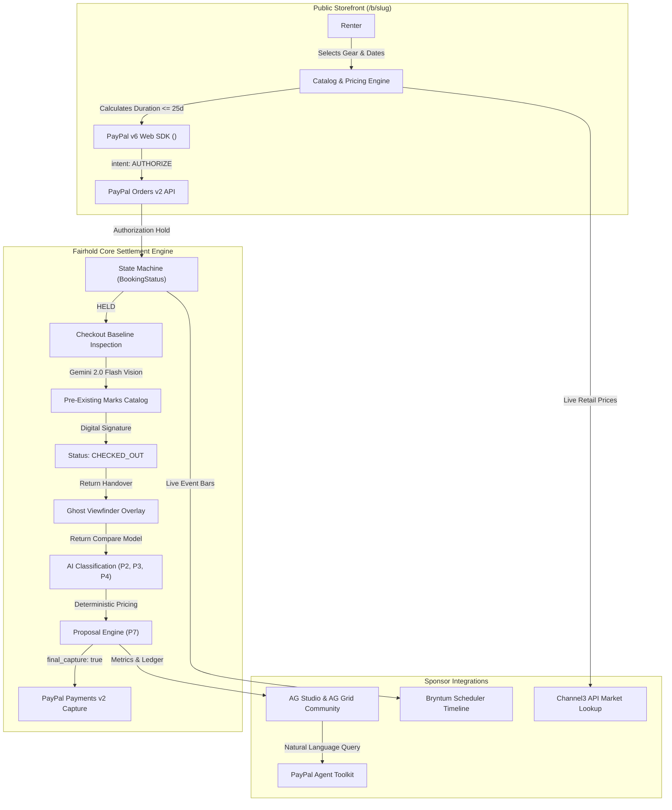
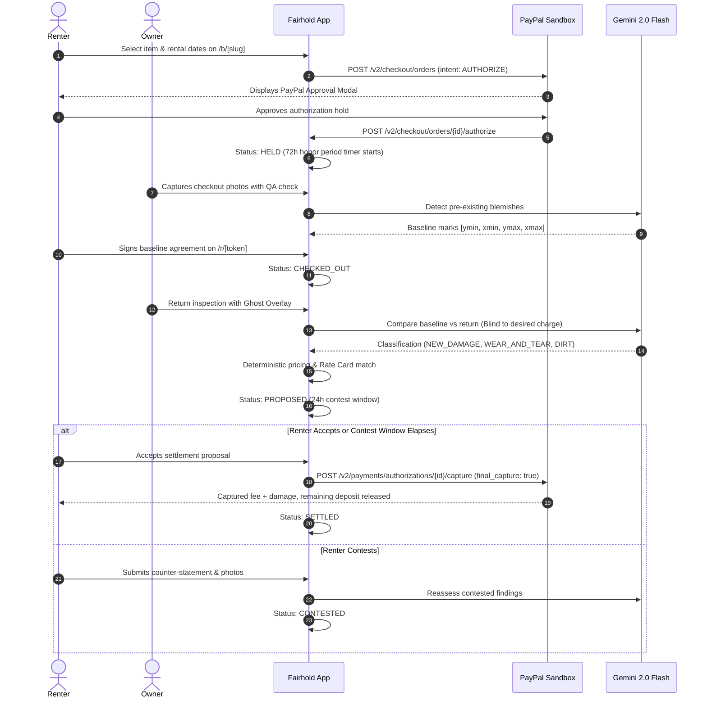

# Fairhold 🛡️📸

> **Rental deposits that settle themselves fairly.**  
> *PayPal holds the deposit, AI compares the item's condition at check-out and return, the renter is charged only for proven new damage, and the rest is released in seconds, with evidence both sides can see.*

[](LICENSE)
[](https://nextjs.org/)
[](https://developer.paypal.com/)
[]()

---

## The Problem

When people rent cameras, bikes, tents, drones, or production equipment, the deposit becomes an adversarial fight at return. Renters get charged for scratches that were already there or for normal cosmetic wear, while owners lack forensic proof of when damage happened. Both sides lose trust, time, and money.

---

## Core Product Mechanics (The 4 Steps)

1. **Authorize Hold (PayPal v6 Web SDK)**: Renter books equipment via `/b/[slug]`. ONE PayPal approval creates an order with `intent="AUTHORIZE"`, holding rental fee + deposit together. No money moves from the renter's account.
2. **Baseline Condition Report**: At equipment pickup, the owner takes standardized photos using the guided viewfinder. AI catalogs pre-existing marks with normalized bounding boxes. The renter reviews the baseline and signs digitally via secure link (`/r/[token]`).
3. **Ghost Return Inspection**: At return, a semi-transparent ghost overlay of the baseline photo aligns the return angle. AI compares the pair, strictly separating new damage from normal wear-and-tear or dust.
4. **Deterministic Settlement & Capture**: If return is clean, 100% of the deposit is released in seconds. If damage is proven, deterministic code calculates rate card or severity percentage (capped at deposit), executes a single PayPal capture with `final_capture=true`, and immediately releases the remainder.

---

## System Architecture



---

## State Machine Sequence



---

## PayPal Developer APIs (Toolkit vs REST)

Fairhold uses official PayPal developer APIs for all money movement:

| Capability | PayPal API / Interface | Method & Endpoint | Purpose in Fairhold |
|---|---|---|---|
| **Rental + Deposit Hold** | Orders v2 | `POST /v2/checkout/orders` (intent: `AUTHORIZE`) | Creates single authorization hold for rental fee + deposit |
| **Authorize Funds** | Orders v2 | `POST /v2/checkout/orders/{id}/authorize` | Holds funds without transferring balance |
| **Single Settlement Capture** | Payments v2 | `POST /v2/payments/authorizations/{id}/capture` | Captures fee + proven damage with `final_capture=true`, releasing deposit remainder |
| **Full Hold Release** | Payments v2 | `POST /v2/payments/authorizations/{id}/void` | Voids hold 100% on cancellation or clean prepaid return |
| **Just-in-Time Reauth** | Payments v2 | `POST /v2/payments/authorizations/{id}/reauthorize` | Reauthorizes holds past 72h honor period for rentals up to 25 days |
| **Sync Disputes** | Customer Disputes v1 | `GET /v1/customer/disputes` | Correlates PayPal disputes to bookings via `seller_transaction_id == captureId` |
| **Submit Evidence PDF** | Customer Disputes v1 | `POST /v1/customer/disputes/{id}/provide-evidence` | Uploads tamper-proof PDF dossier with source-verified claims |
| **Sandbox Adjudication** | Disputes Sandbox Tools | `POST /v1/customer/disputes/{id}/adjudicate` | Resolves dispute in seller or buyer favor for testing |
| **Webhook Deduplication** | Webhooks v1 | `POST /v1/notifications/verify-webhook-signature` | Idempotent event processing with signature verification |
| **AI Financial Intelligence** | `@paypal/agent-toolkit/ai-sdk` | Read-only Tools Integration | Answers natural language questions in AG Studio dashboard |

---

## The 7 Non-Negotiable Principles

| Principle | Rule Description | Enforcing Code |
|---|---|---|
| **P1** | Money moves only through PayPal (hold, capture, void, reauthorize, refund). | `src/lib/paypal/client.ts`, `src/lib/settlement.ts` |
| **P2** | Nothing is charged without photo evidence. Every line item cites coordinates and photo SHA-256 hashes. | `src/lib/eligibility.ts`, `src/lib/pricing.ts` |
| **P3** | Renters are NEVER charged for pre-existing marks acknowledged at check-out, or normal wear and tear defined in written policy. | `src/lib/eligibility.ts` (lines 51–64) |
| **P4** | AI proposes, humans decide. Anything marked `UNCERTAIN` requires owner override with written reason. | `src/lib/eligibility.ts` (lines 30–48) |
| **P5** | Nothing is captured until the renter accepts or the business contest window expires (default 24h). | `src/lib/state-machine.ts`, `src/lib/settlement.ts` |
| **P6** | Every action is logged in an immutable audit trail visible to both parties. | `src/lib/state-machine.ts`, `src/app/r/[token]/page.tsx` |
| **P7** | All money math, timing rules, and charge eligibility are pure deterministic code. LLM never calculates money. | `src/lib/pricing.ts`, `src/lib/timing.ts` |

---

## Sponsor Prizes Integrated

1. **AG Grid's AG Studio (`/owner/analytics`)**:
   - Custom metric KPI cards: Active Deposits Held, Released this week, Damage revenue, Median settlement time.
   - Interactive AG Grid Community table of settled rentals with column sorting, filtering, and live currency formatting.
   - Natural language AG Studio Agent query chat powered by PayPal Agent Toolkit.
2. **Bryntum Scheduler (`/owner/schedule`)**:
   - Equipment items as rows (resources), bookings as status-colored events.
   - Visual timeline markers for PayPal 3-day honor-period expiry and 29-day auth expiry.
   - Fixed hold amount guard preventing rental extension beyond 25-day cap.
3. **Render Deployment (`render.yaml`)**:
   - Full infrastructure blueprint for Node 22 web service, PostgreSQL database, and background reauthorization cron worker.
4. **Channel3 API (`/api/items/channel3-lookup`)**:
   - Real-time market replacement value lookup against verified retail listings with 7-day TTL caching.

---

## Quickstart & Local Setup

### 1. Prerequisites
- Node.js 18+ (tested on Node 22)
- npm

### 2. Clone & Install
```bash
git clone https://github.com/your-username/fairhold.git
cd fairhold
npm install
```

### 3. Environment Variables
Create `.env` (or copy `.env.example`):
```bash
cp .env.example .env
```
Fill in your credentials:
```env
# PayPal Sandbox Credentials
PAYPAL_CLIENT_ID="your_sandbox_client_id"
PAYPAL_CLIENT_SECRET="your_sandbox_secret"
PAYPAL_API_BASE="https://api-m.sandbox.paypal.com"

# AI Provider (Google Gemini default, or Anthropic)
LLM_PROVIDER="google"
LLM_API_KEY="your_gemini_api_key"
LLM_MODEL_TEXT="gemini-2.0-flash"
LLM_MODEL_VISION="gemini-2.0-flash"

# Session & App Config
SESSION_SECRET="your_random_secret_string"
APP_BASE_URL="http://localhost:3000"
```
*(Note: Fairhold includes graceful offline demo simulation modes so the entire judge path functions smoothly out of the box even before API keys are populated).*

### 4. Run Unit Tests
```bash
npm test
```
*Executes all 18 unit tests across timing rules, eligibility engine, pricing formulas, webhook idempotency, and claim filtering.*

### 5. Start Development Server
```bash
npm run dev
```
Open [http://localhost:3000](http://localhost:3000) to test the app.

---

## Try It in 3 Minutes (Judge Walkthrough)

### Act 1: Clean Return (100% Deposit Released)
1. Open [http://localhost:3000/b/summit-shutter](http://localhost:3000/b/summit-shutter).
2. Select **Sony Alpha 7 IV**, pick dates, and click **Authorize Hold with PayPal**.
3. In the Owner Portal at `/owner`, click **Checkout QA** on the booking.
4. Click **"Act 1: Pristine Clean"** demo photo.
5. In the Renter Portal at `/r/[token]`, review the baseline condition report and type your name to sign.
6. When gear returns, open `/owner/inspect/[id]/return` and select **"Act 1: Pristine Clean"**.
7. AI confirms no damage. The proposal shows \$225 rental fee captured and **\$500 deposit released**.
8. Click **Accept & Release**. PayPal captures the fee with `final_capture=true`, instantly releasing the full deposit hold!

### Act 2: Proven New Damage
1. Book an item and sign the checkout baseline report.
2. At return inspection (`/owner/inspect/[id]/return`), click **"Act 2: Gouge Damage ($175)"**.
3. AI detects a new deep gouge into the lens mount bayonet.
4. Deterministic pricing matches Rate Card: `"Chassis dent into frame / bent mount = $175.00"`.
5. Review the proposal: capture fee + \$175 damage, **release remaining \$325 deposit**.
6. Accept proposal: single capture executed with `final_capture=true`.

### Act 3: Dispute Resolution & Evidence PDF
1. Go to `/owner/sandbox`.
2. Click **Sync Sandbox Disputes** to correlate active disputes to the rental case file.
3. Click **Submit PDF Dossier**: Fairhold compiles timestamped photos, the signed checkout agreement, and deterministic math into a court-ready evidence PDF and uploads it to PayPal's Disputes API.
4. Click **Win (Seller)** to test PayPal's Sandbox Adjudication API in seller favor!

---

## License

This project is licensed under the MIT License - see the [LICENSE](LICENSE) file for details.
